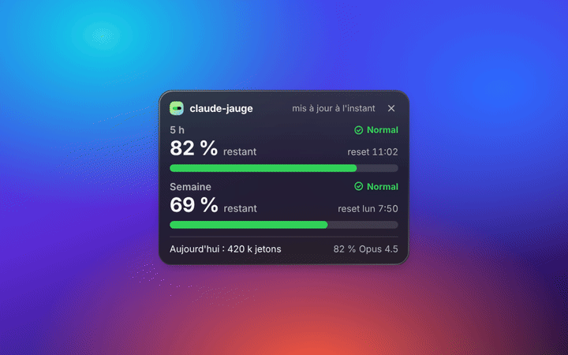
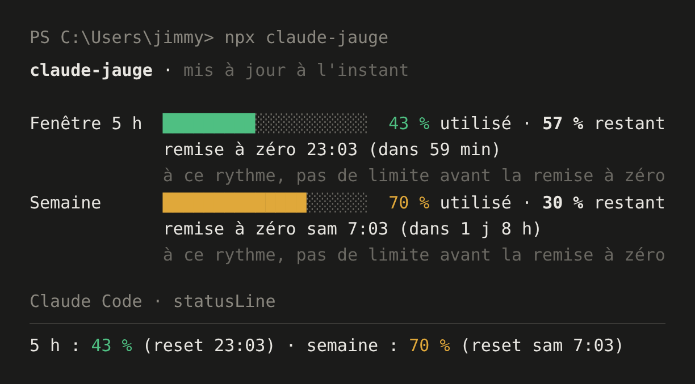
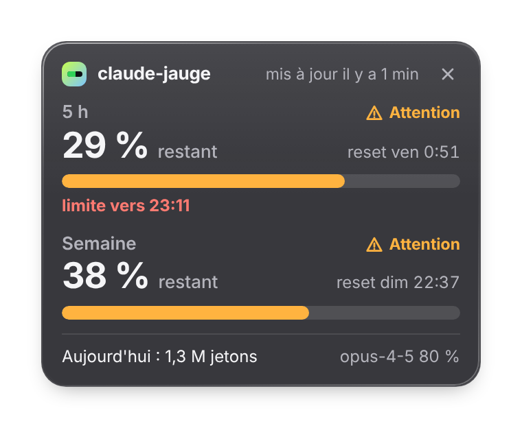
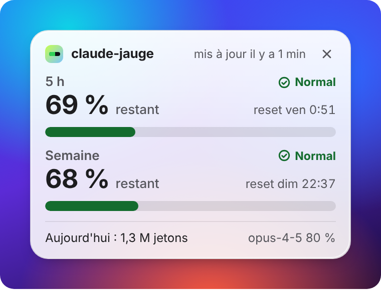
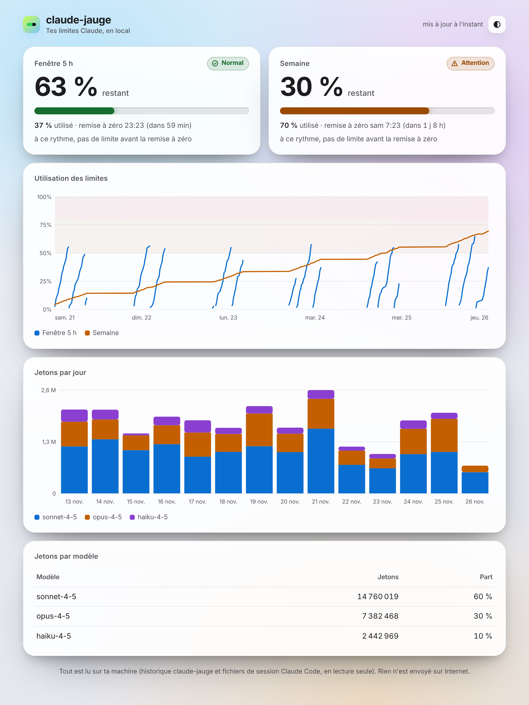
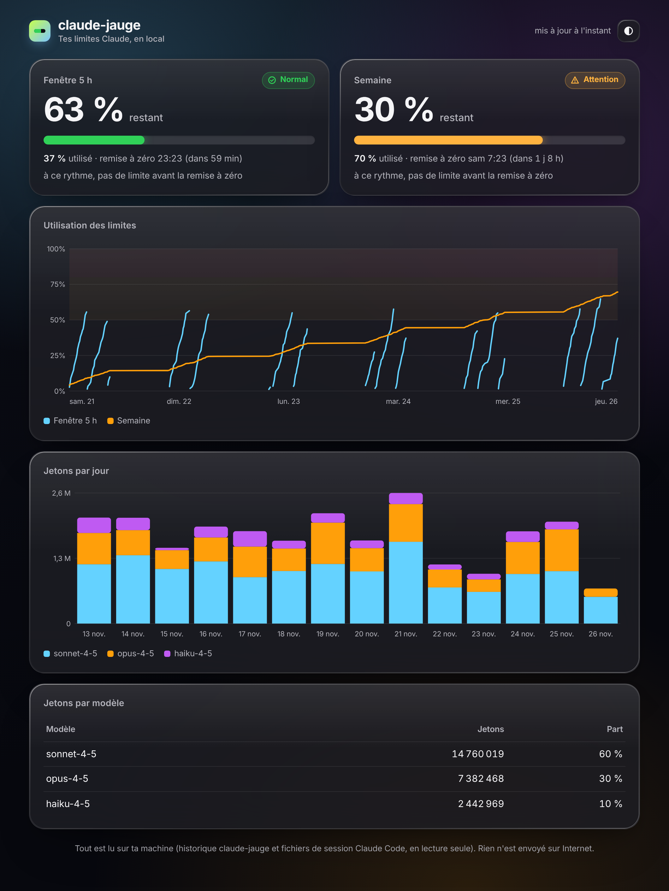

# claude-jauge

[](https://github.com/JimmyBomy/claude-jauge/actions/workflows/ci.yml)


**How much of your Claude limits (Pro / Max) is left while you use Claude Code.**
A status line, a history, a forecast and a small dashboard. Everything stays on your machine.
("jauge" is French for "gauge".)

[Version française](README.md)



**Windows:** [download the installer](https://github.com/JimmyBomy/claude-jauge/releases/latest), run it, it is plugged in.
<sub>Demo made with invented data.</sub>



## Install

You need [Claude Code](https://code.claude.com), Node.js 20 or later, and a **Pro or Max** plan.

```bash
npx claude-jauge install
```

Restart Claude Code. After the first reply, the status line shows:

```
5h: 62% (reset 18:00) · week: 38% (reset Thu 9:00)
```

The percentage is the **used** share of each limit (green, yellow from 50%, red from 80%).
Prefer to see what is left? `npx claude-jauge install --remaining`.

> Not on npm yet? Meanwhile: `npx github:JimmyBomy/claude-jauge install`.

## Usage

| Command | What it does |
| --- | --- |
| `npx claude-jauge` | 5-hour and weekly gauges, reset time, forecast "at this pace, limit reached around 16:40" |
| `npx claude-jauge report` | Tokens per day, week and model (`--days 30`, `--by model`, `--json`) |
| `npx claude-jauge web` | Local dashboard on http://127.0.0.1:4269 (`--open`, `--port`) |
| `npx claude-jauge install` | Adds the status line (`--remaining`, `--force`, `--lang`) |
| `npx claude-jauge uninstall` | Removes it and restores your previous status line, if any |

Language: English or French, auto-detected. Force it with `--lang en` / `--lang fr` (or `CLAUDE_JAUGE_LANG`).
French aliases work too: `rapport`, `--jours`, `--par`, `--restant`.

### Windows widget

A small always-visible window with a tray icon. It refreshes by itself on every Claude Code reply and shows what is
left of the 5-hour and weekly limits, the state (normal, watch out, near limit), the reset time and today's tokens.

 

- `.exe` installer in [Releases](https://github.com/JimmyBomy/claude-jauge/releases).
- Nothing to set up: at launch the widget plugs itself into Claude Code (it adds its status line to
  `~/.claude/settings.json`, with a backup). Then restart Claude Code. Node is not needed: the `.exe` itself is the
  status line.
- If you already have another status line, it is never replaced without your consent: the widget offers a button.
  Uninstalling puts back the one you had.
- Limits only arrive when you use Claude Code **in a terminal** (the `claude` command): the Claude app does not run the
  status line. Since your limits are shared between the app and the terminal, one message sent from the terminal is
  enough to show your real percentage. Today's tokens show up in every case.
- Limits only exist with a Pro or Max plan (signed in with `/login`, not with an API key). If nothing arrives, the widget
  says why, and `claude-jauge doctor` checks the whole chain.
- Starts with Windows from the first launch. To opt out: right click the tray icon and untick "Start with Windows".
  That choice is kept, and uninstalling also removes the startup entry.
- Left click the tray icon to show or hide. Right click for: always on top, glass effect (semi-opaque by default,
  Mica or Acrylic), start with Windows, quit.
- Windows may show a SmartScreen warning on first launch: the installer is not signed (signing certificates cost
  money). Click "More info", then "Run anyway".



<details><summary>Dark theme</summary>



</details>

## How it works

1. **Status line.** Each time its status bar updates, Claude Code pipes a JSON object to the command
   ([official docs](https://code.claude.com/docs/en/statusline)). For Pro and Max subscribers it includes
   `rate_limits.five_hour` and `rate_limits.seven_day`: percentage used (0 to 100) and reset time.
   claude-jauge prints both and stores **at most one point per minute** in `~/.claude-jauge/historique.jsonl`.
2. **Forecast.** A simple linear regression over the points of the current window gives the pace (% per hour).
   If 100% comes before the reset at that pace, the time is shown. It is a trend, not a promise.
3. **Report.** Claude Code session files (`~/.claude/projects/**/*.jsonl`) hold the model, date and token counters
   of every reply. claude-jauge sums them, de-duplicating replies logged several times while streaming.

Install copies the program to `~/.claude-jauge/app` and writes to `~/.claude/settings.json`:

```json
"statusLine": { "type": "command", "command": "node \"C:/Users/you/.claude-jauge/app/cli.js\" statusline", "padding": 0 }
```

So the status line does not depend on the npx cache and starts fast. Forward slashes work in Git Bash and PowerShell
(Claude Code uses one or the other on Windows).

## What is read, and what is not

**Read, locally and read only:**
- the JSON Claude Code passes to the status line (only percentages and reset times are kept);
- in `~/.claude/projects/**/*.jsonl`: date, model and token counters of each reply;
- `~/.claude/settings.json`, only for `install` / `uninstall`.

**Never read:** the content of your conversations and code (lines are parsed but only counters are kept),
your credentials, cookies or session tokens, the claude.ai website, or any non-public API.

**Written:** `~/.claude-jauge/` (history, program copy, install state), the `statusLine` key of
`~/.claude/settings.json`, and a `settings.json.claude-jauge-<date>.bak` backup before every change.

## Privacy

- **Nothing is sent over the Internet.** No telemetry, no network request.
- `claude-jauge web` listens on `127.0.0.1` only, rejects other host names (DNS rebinding protection), and the page
  loads no external resource.
- Zero runtime dependencies: the code running on your machine is the code in this repository.

## Known limits

- Percentages exist only for **Pro and Max**, after Claude Code's first reply. With an API key the status line says
  "limits: not received yet"; `report` still works.
- History only grows while Claude Code runs with the status line.
- Claude Code has a single status line. If you had one, `install` asks for `--force` and `uninstall` restores it.

## claude-jauge and ccusage

[ccusage](https://github.com/ccusage/ccusage) is the reference tool for coding-CLI usage: it reads logs from about twenty
tools (Claude Code, Codex, Gemini CLI…), computes **dollar costs**, has daily, monthly, session and estimated 5-hour block
reports, and a status line. It is mature and far more complete.

claude-jauge does one narrower thing:

| | claude-jauge | ccusage |
| --- | --- | --- |
| **Official** remaining percentages (5h, week), as Claude Code receives them | ✅ | ❌ |
| History of those percentages and forecast of when you will be blocked | ✅ | ❌ |
| Local dashboard with charts | ✅ | ❌ |
| Dollar costs, per-model pricing | ❌ | ✅ |
| Tools other than Claude Code | ❌ | ✅ |
| Token reports by day / week / model | ✅ (basic) | ✅ (much richer) |
| Network | none | anonymous daily usage ping, can be turned off (see their README) |

For costs, use ccusage. For "will I be blocked before 6 pm?", claude-jauge.
claude-jauge is written from scratch; it does not reuse ccusage's code.

## Uninstall

```bash
npx claude-jauge uninstall
```

The status line is removed (or your previous one restored), a backup is made, and `~/.claude-jauge/app` is deleted.
Your history stays in `~/.claude-jauge/`: delete that folder if you do not want it.

## Development

```bash
git clone https://github.com/JimmyBomy/claude-jauge && cd claude-jauge
npm install      # also compiles (TypeScript)
npm test         # node:test, invented sample data in test/fixtures
node scripts/demo-data.mjs /tmp/demo   # fake dataset for screenshots
```

Useful variables: `CLAUDE_CONFIG_DIR` (Claude Code folder, as Claude Code itself), `CLAUDE_JAUGE_HOME`, `NO_COLOR`.

## License

[MIT](LICENSE) © Jimmy ([JimmyBomy](https://github.com/JimmyBomy)). Independent project, not affiliated with Anthropic.
