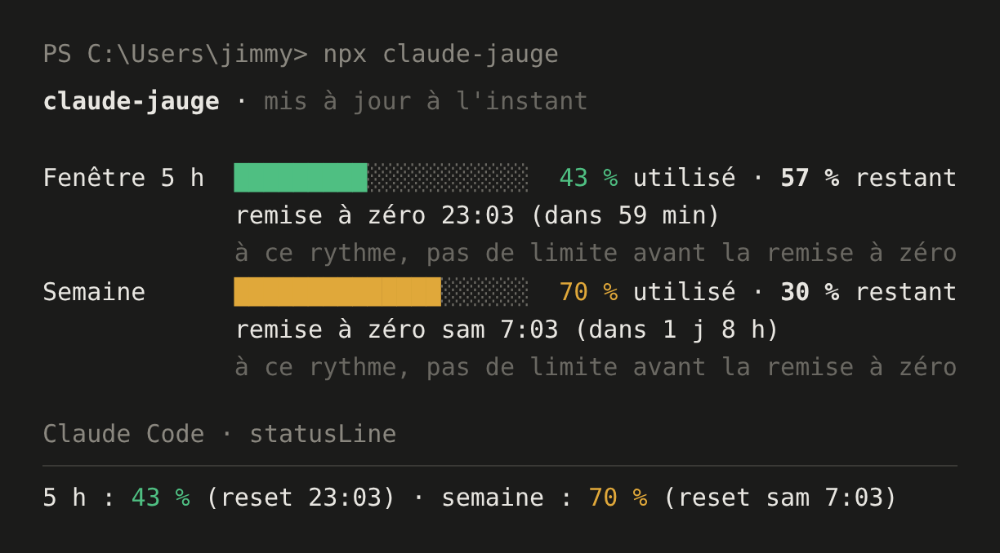
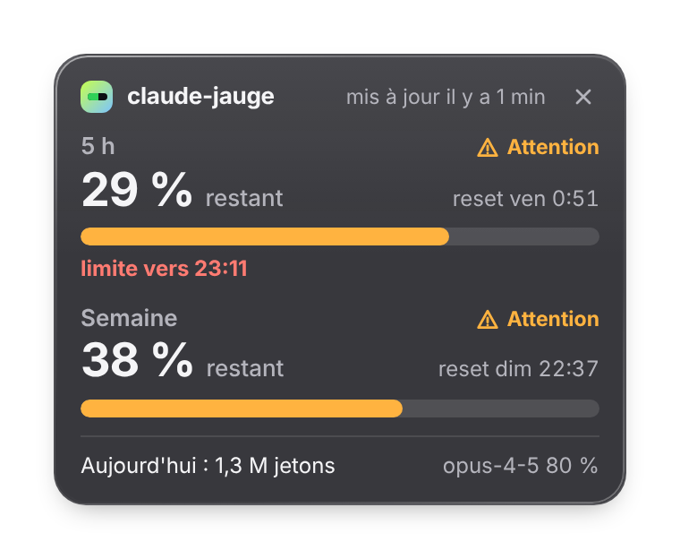
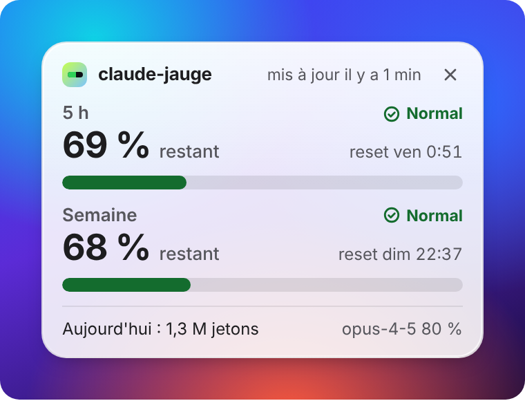
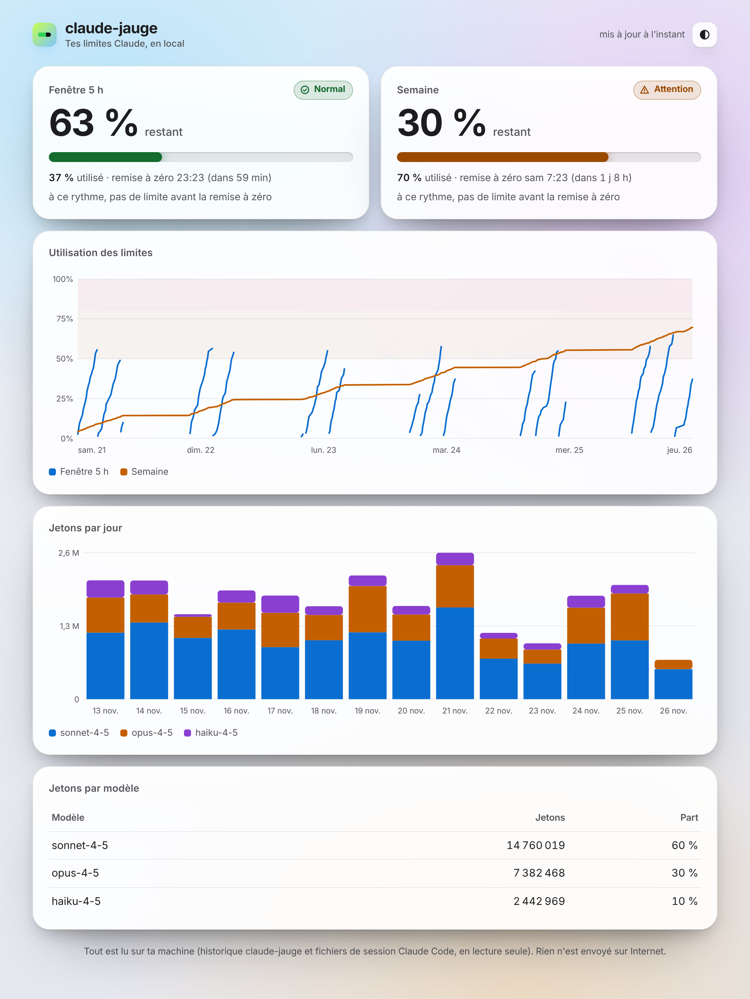
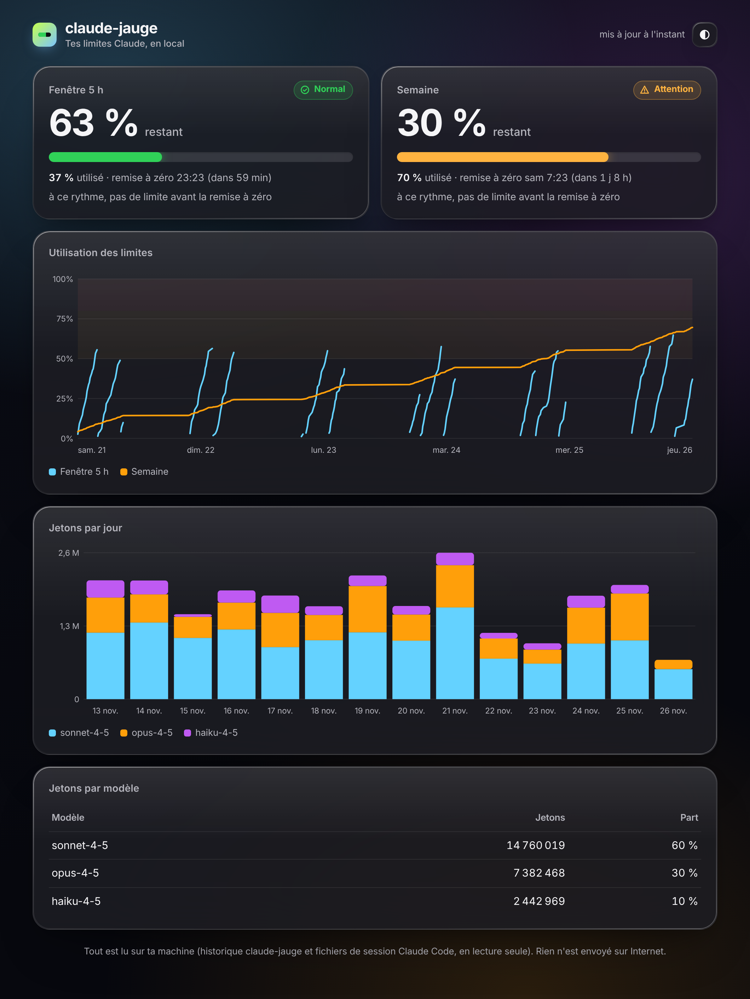

# claude-jauge

[](https://github.com/JimmyBomy/claude-jauge/actions/workflows/ci.yml)


**Combien il te reste de tes limites Claude (Pro / Max) pendant que tu utilises Claude Code.**
Une ligne dans la barre d'état, un historique, une prévision et un petit tableau de bord. Tout reste sur ta machine.

[English version](README.en.md)



## Installation

Il te faut [Claude Code](https://code.claude.com), Node.js 20 ou plus, et un abonnement **Pro ou Max**.

```bash
npx claude-jauge install
```

Puis redémarre Claude Code. Dès la première réponse, la barre d'état affiche :

```
5 h : 62 % (reset 18:00) · semaine : 38 % (reset jeu 9:00)
```

Le pourcentage est la part **utilisée** de chaque limite (vert, puis jaune à 50 %, rouge à 80 %).
Tu préfères voir ce qui reste ? `npx claude-jauge install --restant`.

> Pas encore publié sur npm ? En attendant : `npx github:JimmyBomy/claude-jauge install`.

## Utilisation

| Commande | Ce que ça fait |
| --- | --- |
| `npx claude-jauge` | Jauges 5 h et semaine, heure de remise à zéro, prévision « à ce rythme, limite atteinte vers 16:40 » |
| `npx claude-jauge rapport` | Jetons par jour, par semaine et par modèle (`--jours 30`, `--par modele`, `--json`) |
| `npx claude-jauge web` | Tableau de bord local sur http://127.0.0.1:4269 (`--open`, `--port`) |
| `npx claude-jauge install` | Ajoute la statusLine (`--restant`, `--force`, `--lang`) |
| `npx claude-jauge uninstall` | La retire et restaure ta statusLine précédente s'il y en avait une |

Langue : français ou anglais, détectée automatiquement. Force-la avec `--lang fr` ou `--lang en`
(ou la variable `CLAUDE_JAUGE_LANG`).

### Widget Windows

Une petite fenêtre toujours visible, avec une icône près de l'horloge. Elle se met à jour toute seule à chaque réponse de
Claude Code et affiche le restant 5 h et semaine, l'état (normal, attention, limite proche), l'heure de remise à zéro et
les jetons du jour.

 

- Installeur `.exe` dans les [Releases](https://github.com/JimmyBomy/claude-jauge/releases).
- La statusLine doit être installée (`claude-jauge install`) : c'est elle qui fournit les limites.
- Démarre tout seul avec Windows dès le premier lancement. Pour l'éviter : clic droit sur l'icône, puis décocher
  « Lancer au démarrage de Windows ». Ce choix est conservé ; la désinstallation retire aussi l'entrée de démarrage.
- Clic gauche sur l'icône pour afficher ou masquer. Clic droit pour : toujours au premier plan, effet verre
  (fond semi-opaque par défaut, Mica ou Acrylique), lancement au démarrage de Windows, quitter.
- Windows peut afficher un avertissement SmartScreen au premier lancement : l'installeur n'est pas signé
  (un certificat de signature est payant). « Informations complémentaires » puis « Exécuter quand même ».



<details><summary>Thème sombre</summary>



</details>

## Comment ça marche

1. **La statusLine.** À chaque mise à jour de sa barre d'état, Claude Code envoie à la commande un JSON
   ([documentation officielle](https://code.claude.com/docs/en/statusline)). Pour les abonnés Pro et Max, il contient
   `rate_limits.five_hour` et `rate_limits.seven_day` : le pourcentage utilisé (0 à 100) et l'heure de remise à zéro.
   claude-jauge affiche ces deux valeurs et en garde **au plus un point par minute** dans `~/.claude-jauge/historique.jsonl`.
2. **La prévision.** Une régression linéaire simple sur les points de la fenêtre en cours donne le rythme
   (en % par heure). Si, à ce rythme, 100 % arrive avant la remise à zéro, l'heure est affichée.
   C'est une tendance, pas une promesse : une pause ou un gros prompt la change.
3. **Le rapport.** Les fichiers de session de Claude Code (`~/.claude/projects/**/*.jsonl`) contiennent, pour chaque
   réponse, le modèle, la date et les compteurs de jetons. claude-jauge les additionne. Les réponses répétées pendant le
   streaming sont dédoublonnées.

L'installation copie le programme dans `~/.claude-jauge/app` et écrit dans `~/.claude/settings.json` :

```json
"statusLine": { "type": "command", "command": "node \"C:/Users/toi/.claude-jauge/app/cli.js\" statusline", "padding": 0 }
```

Ainsi la barre d'état ne dépend pas du cache de npx et démarre vite. Le chemin utilise des `/`, ce qui fonctionne avec
Git Bash comme avec PowerShell (Claude Code utilise l'un ou l'autre sous Windows).

## Ce qui est lu, et ce qui ne l'est pas

**Lu, en local et en lecture seule :**
- le JSON que Claude Code transmet à la statusLine (on n'en garde que les pourcentages et heures de remise à zéro) ;
- dans `~/.claude/projects/**/*.jsonl` : la date, le modèle et les compteurs de jetons de chaque réponse ;
- `~/.claude/settings.json`, uniquement pour `install` / `uninstall`.

**Jamais lu :** le contenu de tes conversations et de ton code (les lignes sont lues mais seuls les compteurs sont conservés),
tes identifiants, cookies ou jetons de session, le site claude.ai, ni aucune API non publique.

**Écrit :** `~/.claude-jauge/` (historique, copie du programme, état d'installation), la clé `statusLine` de
`~/.claude/settings.json`, et une sauvegarde `settings.json.claude-jauge-<date>.bak` avant chaque modification.

## Confidentialité

- **Rien n'est envoyé sur Internet.** Aucune télémétrie, aucune requête réseau.
- `claude-jauge web` écoute uniquement sur `127.0.0.1` (inaccessible depuis le réseau), refuse les autres noms d'hôte
  (protection contre le DNS rebinding) et la page ne charge aucune ressource externe.
- Zéro dépendance à l'exécution : le code qui tourne chez toi est celui de ce dépôt, rien d'autre.

## Limites connues

- Les pourcentages n'existent que pour **Pro et Max** et après la première réponse de Claude Code. Avec une clé API,
  la barre affiche « limites : pas encore reçues » ; `rapport` fonctionne quand même.
- L'historique ne se remplit que quand Claude Code tourne avec la statusLine : pas de session, pas de point.
- Une seule statusLine est possible dans Claude Code. Si tu en avais une, `install` demande `--force` et
  `uninstall` la remet.

## claude-jauge et ccusage

[ccusage](https://github.com/ccusage/ccusage) est l'outil de référence pour analyser l'usage des CLI de code : il lit
les journaux d'une vingtaine d'outils (Claude Code, Codex, Gemini CLI…), calcule les **coûts en dollars**, propose des
rapports par jour, mois, session et par blocs de 5 h estimés, et une statusLine. Il est mûr et très complet.

claude-jauge fait une chose plus étroite :

| | claude-jauge | ccusage |
| --- | --- | --- |
| Pourcentages **officiels** restants (5 h, semaine), tels que Claude Code les reçoit | ✅ | ❌ |
| Historique de ces pourcentages et prévision de l'heure de blocage | ✅ | ❌ |
| Tableau de bord local avec graphiques | ✅ | ❌ |
| Coûts en dollars, tarifs par modèle | ❌ | ✅ |
| Autres outils que Claude Code | ❌ | ✅ |
| Rapports jetons par jour / semaine / modèle | ✅ (simple) | ✅ (bien plus riche) |
| Réseau | aucun | ping d'usage anonyme quotidien, désactivable (voir leur README) |

Pour les coûts, utilise ccusage. Pour savoir « est-ce que je vais être bloqué avant 18 h ? », claude-jauge.
Le code de claude-jauge est écrit de zéro ; il ne reprend pas celui de ccusage.

## Désinstaller

```bash
npx claude-jauge uninstall
```

La statusLine est retirée (ou ta précédente est restaurée), une sauvegarde est faite, et `~/.claude-jauge/app` est supprimé.
Ton historique reste dans `~/.claude-jauge/` : supprime ce dossier si tu n'en veux plus.

## Développement

```bash
git clone https://github.com/JimmyBomy/claude-jauge && cd claude-jauge
npm install      # compile aussi (TypeScript)
npm test         # node:test, données d'exemple inventées dans test/fixtures
node scripts/demo-data.mjs /tmp/demo   # jeu de données fictif pour les captures
```

Variables utiles : `CLAUDE_CONFIG_DIR` (dossier de Claude Code, comme Claude Code lui-même), `CLAUDE_JAUGE_HOME`
(dossier de claude-jauge), `NO_COLOR`.

## Licence

[MIT](LICENSE) © Jimmy ([JimmyBomy](https://github.com/JimmyBomy)). Projet indépendant, non affilié à Anthropic.
